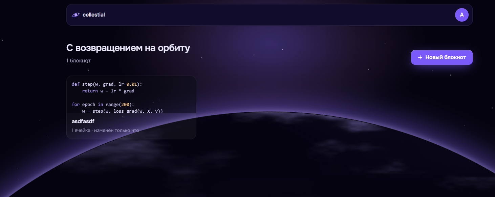
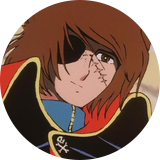

# Backend Colab

Backend проекта «Colab» (Cellestial) команды «Cringe Driven Development»: Go API и агент исполнения Python.

## Навигация

- 🚀 Начало работы
  - [Запуск Go API](docs/local-development.md#запуск-и-проверки)
  - [Проверки перед PR](docs/local-development.md#проверки-перед-pr)
- 📚 Документация
  - [Локальная разработка](docs/local-development.md)
  - [Контракт API](docs/apidog.md)
  - [Окружения и исполнение Python](docs/runtime-sessions.md)
  - [CI и выкатка](docs/release.md)
  - [Архитектура проекта](https://docs.cellestial.ru/documentation/architecture/)
  - [Wiki кода](openwiki/quickstart.md)
- 🛠 Разработка
  - [Go API](internal/)
  - [Агент Python](runtime-agent/README.md)
  - [Миграции БД](migrations/)
  - [Правила работы с задачами](docs/local-development.md#как-работать-с-задачами)
  - [Инструкции для агентов](AGENTS.md)

## Команда

<table>
  <thead>
    <tr>
      <th>🎨 Frontend + Design</th>
      <th>⚙️ DevOps</th>
      <th colspan="2">🗄️ Backend</th>
    </tr>
  </thead>
  <tbody>
    <tr>
      <td align="center">
         
        <a href="https://github.com/ManInTheCoat">Ерофей Гаранин</a>
      </td>
      <td align="center">
         
        <a href="https://github.com/iRedTea">Денис Истратов</a>
      </td>
      <td align="center">
         
        <a href="https://github.com/GrayMouse9">Дарья Шпакова</a>
      </td>
      <td align="center">
         
        <a href="https://github.com/MrDuckVC">Валентин Кунев</a>
      </td>
    </tr>
  </tbody>
</table>

### Менторы

<table>
  <thead>
    <tr>
      <th>💻 Frontend</th>
      <th>🗄️ Backend</th>
      <th>🎨 UX</th>
    </tr>
  </thead>
  <tbody>
    <tr>
      <td align="center">
         
        <a href="https://github.com/YarikMix">Ярослав Михалёв</a>
      </td>
      <td align="center">
         
        <a href="https://github.com/blackHATred">Александр Батовкин</a>
      </td>
      <td align="center">
         
        <a href="https://t.me/dewon_d">Дарья Ченцова</a>
      </td>
    </tr>
  </tbody>
</table>

